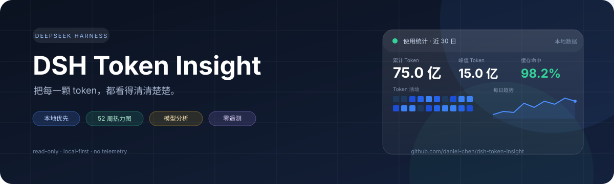
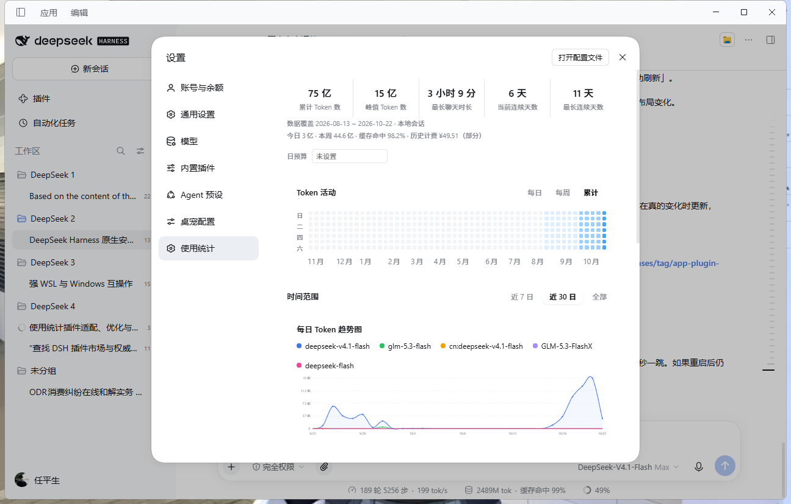
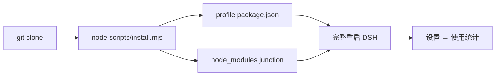
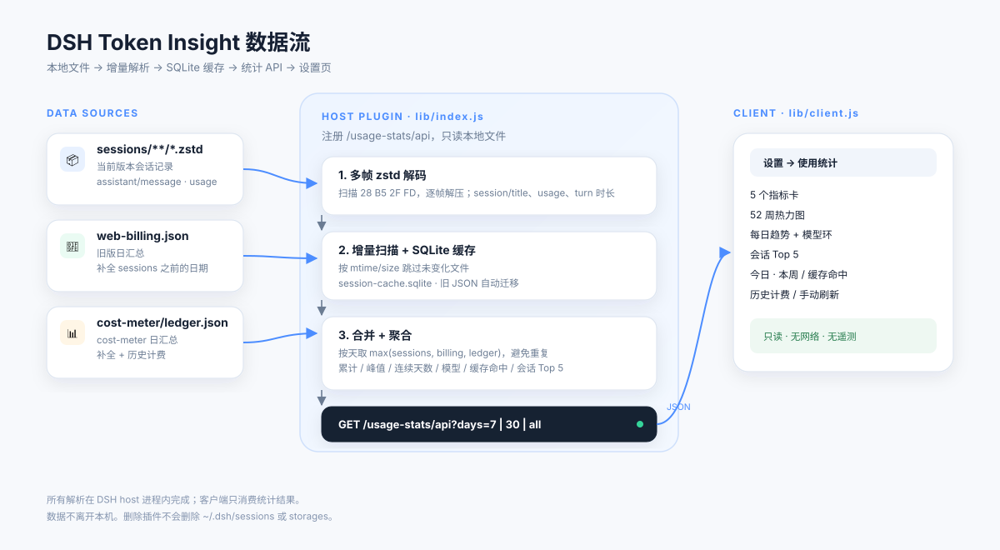

<div align="center">



# DSH Token Insight

**把每一颗 token，都看得清清楚楚。**

DeepSeek Harness（DSH）的本地使用统计插件：累计/峰值 Token、连续天数、52 周热力图、
每日趋势、模型用量、会话 Top 5、成本与导出。

[](CHANGELOG.md)
[](https://github.com/daniei-chen/DeepSeek-Harness-APP)
[](https://nodejs.org/)
[](LICENSE)
[](#数据来源与隐私)

[快速开始](#快速开始) · [界面导览](#界面导览) · [数据流](#数据流) · [API](#api) · [常见问题](#常见问题)

</div>

---

## 它是什么

DSH Token Insight 是一个装在 **DSH host** 上的本地插件。安装后，DSH 的
`设置 → 使用统计` 会出现一个完整的使用面板：

- 数据只来自本机 `~/.dsh`，不联网、不上传、不需要账号或 API key
- 直接解析当前版本的 `session.v4.jsonl.zstd`，不是估算
- 增量扫描 + SQLite 缓存，第二次打开很快
- 明确标注数据覆盖范围，缺档时不会把“没记录”误看成“没使用”

> **给 AI / For AI agents：** 先读
> [docs/INSTALL_FOR_AGENTS.md](docs/INSTALL_FOR_AGENTS.md)，里面有逐步命令、验收检查和排错。
> 手机 App 是另一个项目，见 [手机 App](#手机-app)。

## 界面截图



> 桌面端截图；手机端 52 周热力图比屏幕宽，**可左右滑动**，并会自动定位到最近几周。

## 功能一览

| 模块 | 能力 |
| --- | --- |
| **5 个总览指标** | 累计 Token、峰值 Token、最长聊天时长、当前连续天数、最长连续天数 |
| **52 周热力图** | 每日 / 每周 / 累计三种模式；悬停显示日期、token、轮消息 |
| **每日趋势** | 近 7 日 / 近 30 日 / 全部；平滑曲线、面积渐变、hover 十字线 |
| **模型用量** | 环形图 + 明细列表；图例点击隐藏模型，环形图点击筛选 |
| **数据覆盖** | 实际起止日期；今日、本周、缓存命中率 |
| **会话 Top 5** | 会话标题、Token、时长；快速看出谁最“费 token” |
| **导出** | CSV / JSON / PNG，方便存档或发群 |
| **日预算** | 本机 localStorage；超预算提示，不影响统计 |
| **历史计费** | 从旧 `web-billing` / `cost-meter` 补出部分费用，并标注“部分” |
| **主题适配** | 跟随 DSH 深色/浅色主题；手机端横向滚动、骨架屏 |

## 快速开始

### 一键安装（推荐）

```bash
git clone https://github.com/daniei-chen/dsh-token-insight.git
cd dsh-token-insight
node scripts/install.mjs --profile desktop
# 完整重启 DSH（关闭应用再打开）
```

脚本会：

1. 把 `dsh-token-insight` 写入 `~/.dsh/profiles/desktop/package.json`
2. 加入 `dsh.profile.bundles`
3. 在 profile 的 `node_modules` 下建立指向本仓库的 junction / symlink

安装完成后，打开 `设置 → 使用统计`。

<details>
<summary><b>没有脚本 / 不想克隆仓库？</b></summary>

**GitHub Release 下载：**

[dsh-token-insight-0.5.1.tgz](https://github.com/daniei-chen/dsh-token-insight/releases/download/v0.5.1/dsh-token-insight-0.5.1.tgz)

在 DSH 插件管理器里选择这个 tgz，或解压到
`~/.dsh/profiles/desktop/node_modules/dsh-token-insight`。

**手动改 profile：**

```json
{
  "dependencies": {
    "dsh-token-insight": "file:/absolute/path/to/dsh-token-insight"
  },
  "dsh": {
    "profile": {
      "bundles": ["...", "dsh-token-insight"]
    }
  }
}
```

```powershell
# Windows
New-Item -ItemType Junction `
  -Path "$HOME/.dsh/profiles/desktop/node_modules/dsh-token-insight" `
  -Target "<absolute-path-to-dsh-token-insight>"
```

```bash
# macOS / Linux
ln -s "<absolute-path-to-dsh-token-insight>" \
  "$HOME/.dsh/profiles/desktop/node_modules/dsh-token-insight"
```

</details>

### 安装流程



### 环境要求

| 项目 | 要求 |
| --- | --- |
| DSH | `0.2.1-rc.2` 或更新 |
| Profile | `desktop`（默认） |
| DSH runtime Node | Node 24（插件使用内置 `node:sqlite`） |
| 手机 App | 可选，见 [手机 App](#手机-app) |

`DSH_HOME` 默认是 `~/.dsh`；如果自定义了，安装脚本和插件都会读取它。

## 界面导览

对应上面的截图，从上到下：

1. **总览卡**：累计 / 峰值 / 最长聊天 / 当前连续 / 最长连续，全部时间口径
2. **数据覆盖**：`2026-08-13 ~ 2026-10-22 · 本地会话`
3. **今日 / 本周 / 缓存命中 / 历史计费**：一行看清近期状态
4. **日预算**：输入数字后，显示今日已用百分比
5. **Token 活动**：52 周热力图，可切换每日 / 每周 / 累计
6. **时间范围**：近 7 日 / 近 30 日 / 全部
7. **每日 Token 趋势图**：按模型分色，图例可点击隐藏
8. **模型用量**：环形图 + 明细列表
9. **会话用量 Top 5**：按会话看 Token 和时长
10. **导出 / 刷新**：CSV、JSON、PNG

## 数据流



一句话：**host 侧只读解析，client 侧只消费统计结果。**

- 当前会话：`~/.dsh/sessions/**/session.v4.jsonl.zstd`
- 旧版日汇总：`~/.dsh/storages/web-billing.json`
- cost-meter 日汇总：`~/.dsh/storages/cost-meter/ledger.json`
- 增量缓存：`~/.dsh/dsh-usage-stats/session-cache.sqlite`

同一自然日如果 sessions 与旧 billing/ledger 都有记录，按 `max()` 合并，避免重复累加。
插件不写 `sessions`、不写 `storages`，只读这些文件。

## 数据来源与隐私

| 文件 | 用途 | 插件行为 |
| --- | --- | --- |
| `~/.dsh/sessions/**/*.zstd` | 当前版本会话记录、usage、turn 时长 | 只读 |
| `~/.dsh/storages/web-billing.json` | 旧版本日汇总 | 只读，按天补全 |
| `~/.dsh/storages/cost-meter/ledger.json` | cost-meter 日汇总 / 历史计费 | 只读，按天补全 |
| `~/.dsh/dsh-usage-stats/session-cache.sqlite` | 增量缓存 | 读写 |

- 不发起网络请求
- 不上传会话内容
- 不需要账号、API key 或云端服务
- 统计结果只在本机 DSH 页面内渲染

## 数据口径

| 指标 | 计算方式 |
| --- | --- |
| 累计 Token | `usage.totalTokens`；旧消息缺失时用 `input + cacheRead + output + reasoning + cacheCreation` 补算 |
| 峰值 Token | 单日最大 Token 消耗 |
| 最长聊天时长 | 单个 turn（`turn/start` → `turn/end`）的最大跨度 |
| 当前/最长连续 | 有 Token 消耗的自然日连续段 |
| 缓存命中率 | `cacheRead / (input + cacheRead)` |
| 热力图 | 最近 52 周，周日起始；每日 / 每周 / 累计 |
| 历史计费 | 旧 billing 的 `totals.cost` 或 ledger 的日 `cost` 之和，标注“部分” |

## 手机 App

手机端是独立项目：[**DeepSeek-Harness-APP**](https://github.com/daniei-chen/DeepSeek-Harness-APP)。

| 组件 | 装在哪 | 作用 |
| --- | --- | --- |
| `dsh-token-insight`（本仓库） | 运行 DSH 的电脑 | 提供 `设置 → 使用统计` |
| DeepSeek-Harness-APP | 手机 + DSH host | Android WebView 壳、连接、通知、文件、Relay |

**插件不需要装到手机上。** 手机 App 只是显示 DSH Web UI；插件装在 host 后，手机打开
`设置 → 使用统计` 即可看到同一份数据。

App 的完整安装步骤见 app 仓库的
[**docs/INSTALL_FOR_AGENTS.md**](https://github.com/daniei-chen/DeepSeek-Harness-APP/blob/main/docs/INSTALL_FOR_AGENTS.md)。

## 验证安装

```bash
# 1. 模块能解析
cd "$HOME/.dsh/profiles/desktop"
node -e "console.log(require.resolve('dsh-token-insight/client'))"

# 2. API 正常（端口换成 DSH Web GUI 端口）
curl "http://127.0.0.1:<port>/usage-stats/api?days=30"

# 3. 全部范围（0.5.1 新 host）
curl "http://127.0.0.1:<port>/usage-stats/api?days=all"
```

期望：`"ok": true`，并包含 `totalTokens`、`peakTokens`、`longestChat`、`models`、
`cacheHitRate`、`todayTokens`、`weekTokens`、`sessionsTop`、`coverage`。

## API

`GET /usage-stats/api?days=7|30|all`

| 字段 | 说明 |
| --- | --- |
| `version` | host 版本 |
| `days` | `7` / `30` / `0`（全部） |
| `coverage` | `firstDay`、`lastDay`、`sources` |
| `totalTokens` / `peakTokens` | 累计 / 单日峰值 |
| `longestChat` | 最长聊天时长（本地化字符串） |
| `currentStreak` / `longestStreak` | 当前 / 最长连续天数 |
| `cacheHitRate` | 缓存命中率（0–100） |
| `todayTokens` / `weekTokens` | 今日 / 近 7 日 |
| `cost` | `{ amount, currency, partial, source }` 或 `null` |
| `dayList` | `[{ date, tokens }]` |
| `dayModels` | `{ date: { model: tokens } }` |
| `models` | `[{ name, tokens, pct }]` |
| `sessionsTop` | `[{ id, title, tokens, duration }]` |
| `heatList` | `[{ date, tokens, calls }]` |

## 常见问题

| 现象 | 处理 |
| --- | --- |
| 设置里同时出现「DSH 使用统计」和「使用统计」 | 旧包 `@dsh-external/dsh-usage-stats` 还在运行中的进程里；确认 profile 只剩 `dsh-token-insight`，**完整重启 DSH** |
| 插件列表还有旧「DSH 使用统计」 | 同上；删除旧 `node_modules/@dsh-external/dsh-usage-stats` 后重启 |
| 热力图显示 `0 轮消息` | host 还是旧版；完整重启 DSH |
| 手机端热力图看起来是空的 | 数据在 52 周网格右侧；0.5.1 会自动滚到最近几周，也可以左右滑动 |
| `/usage-stats/api` 404 | 插件没加载、profile 不对，或端口不是 DSH Web GUI 端口 |
| `Cannot find module 'node:sqlite'` | DSH runtime Node 低于 22.5；升级到 Node 24 的 DSH |
| 没有数据 | 确认 `~/.dsh/sessions` 有 `.zstd`；先在 DSH 里跑几个任务 |
| `全部` 比 `近 30 日` 少 | 旧 host 把 `days=all` 当成 7 天；完整重启 DSH |

## 更新

```bash
cd dsh-token-insight
git pull
node scripts/install.mjs --profile desktop
# 完整重启 DSH
```

## 卸载

1. 从 `~/.dsh/profiles/desktop/package.json` 删除 `dsh-token-insight`（dependencies 和
   `dsh.profile.bundles` 都要删）
2. 删除 `~/.dsh/profiles/desktop/node_modules/dsh-token-insight`
3. 重启 DSH
4. 可选：删除缓存 `~/.dsh/dsh-usage-stats/session-cache.sqlite` 和旧的
   `~/.dsh/dsh-usage-stats/session-cache.json`

删除插件不会删除 `~/.dsh/sessions` 或 `~/.dsh/storages`。

## 开发与测试

```bash
node scripts/install.mjs --profile desktop   # 安装/更新到 profile
node sync.mjs                                  # 同步到已安装副本
npm run verify                                 # 语法检查 + host 单测
npm pack                                       # 重新打包
```

- host：`lib/index.js`
- client：`lib/client.js`
- 测试：`test/host.test.mjs`
- 安装器：`scripts/install.mjs`

修改 host 后需要完整重启 DSH；只刷新页面不够。

## 项目结构

```text
dsh-token-insight/
├─ lib/
│  ├─ index.js            # host：解析、缓存、聚合、API
│  └─ client.js           # client：设置页 UI
├─ locale/
│  ├─ zh.json
│  └─ en.json
├─ scripts/
│  └─ install.mjs         # profile 安装器
├─ test/
│  └─ host.test.mjs       # 多帧 zstd / 统计口径测试
├─ docs/
│  ├─ INSTALL_FOR_AGENTS.md
│  ├─ CI.md
│  ├─ PUBLISH.md
│  ├─ banner.svg
│  ├─ architecture.svg
│  └─ screenshot.png
├─ cordis.patch.yml
├─ package.json
└─ README.md
```

## Roadmap

- [x] 0.5.0：全部范围、数据覆盖、缓存命中、会话 Top 5、导出、预算、SQLite 缓存
- [x] 0.5.1：tooltip 挂 body，兼容 Catppuccin glass 等会 transform 弹窗的主题
- [ ] 0.6：真实成本账本（按模型单价、缓存节省）
- [ ] 0.6：会话下钻（点击 Top 5 / 峰值日期看明细）
- [ ] 0.6：今日常驻小部件（侧边栏 / 桌宠气泡）
- [ ] 0.7：7 日/30 日环比、周报长图
- [ ] 0.7：多设备 / 多 profile 汇总
- [ ] 0.8：TypeScript + 构建、worker 扫描、E2E 测试

## 相关文档

- [AI 安装指南](docs/INSTALL_FOR_AGENTS.md)
- [CI / 验证](docs/CI.md)
- [npm 发布](docs/PUBLISH.md)
- [CHANGELOG](CHANGELOG.md)

## License

MIT
